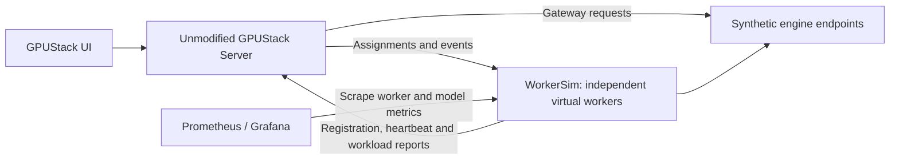

# GPUStack WorkerSim

[](https://github.com/pengjiang80/gpustack-workersim/actions/workflows/ci.yml)
[](https://hub.docker.com/r/gpustack/gpustack-workersim)
[](pyproject.toml)
[](https://github.com/gpustack/gpustack)

**Test GPUStack scheduling, deployment lifecycles, and monitoring on CPU-only machines.**

WorkerSim is a standalone worker protocol simulator for unmodified GPUStack **2.3.1**. One process can register up to **100 independent workers**, expose virtual GPU/NPU inventories, receive assignments from the real scheduler, and report synthetic monitoring data to the standard UI.

[中文说明](README.zh-CN.md) · [Quick start](#quick-start) · [Configuration](#configuration) · [Validation](#validation) · [Publishing](docs/publishing.md)

> GPUStack Server performs the scheduling; WorkerSim simulates the workers. No GPU hardware, model weights, or inference engines are required. Synthetic throughput, latency, utilization, and power values are not hardware benchmarks.

## Features

- **Independent identities:** worker registration, credentials, heartbeat, authenticated APIs, and persistent identities across restarts.
- **Configurable hardware:** worker count, accelerator profile, cards per worker, CPU, RAM, disk, and labels. Supports NVIDIA GPUs and Ascend CANN NPUs.
- **Deployment lifecycles:** receives real assignments and reports initialization, startup, running, failure, and stop transitions.
- **Scheduling scenarios:** ordinary replicas, cross-worker placement, PD prefill/decode/router roles, and tested vLLM/SGLang orchestration layouts with generation-fenced workload reports.
- **Event reconciliation:** separate model-instance and model-file watches, reconnect handling, paginated snapshots, and cleanup after scale-down or deletion.
- **Model-file simulation:** download progress, Ready state, virtual paths, and synthetic file sizes without downloading weights.
- **Native monitoring:** device utilization, VRAM use/allocation, temperature, power, model request/token counters, latency histograms, and supported KV-cache/PD/router metrics.
- **Synthetic APIs:** chat, streaming chat, embeddings, reranking, transcription, and a short silent WAV speech fixture.
- **Fault controls:** simulate offline workers and runtime failure, then exercise GPUStack's normal recovery flow.

## Architecture



Server and WorkerSim can share a CPU host or run on different hosts. Server and Prometheus must be able to reach the advertised worker addresses.

## Quick start

### 1. Configure a test cluster

Use an existing GPUStack **2.3.1** Server. Create a test cluster in the UI and obtain its worker registration token from the **Add Worker** instructions.

```bash
git clone https://github.com/pengjiang80/gpustack-workersim.git
cd gpustack-workersim
```

Edit [`configs/docker.yaml`](configs/docker.yaml):

- `server.url`: Server root URL as reached from WorkerSim; do not append `/v2`.
- `server.cluster_id`: optionally specify the target cluster ID.
- `network.advertise_address` and `network.worker_ip`: an address reachable from Server and Prometheus.

The Docker example assumes a Linux host, Server on Docker's default bridge, and WorkerSim using host networking. `172.17.0.1` is an example gateway; use your host's actual address. A Server container's `127.0.0.1` refers to that container.

### 2. Reserve service ports

Before starting a fleet, reserve its inference port pool against automatic Linux source-port allocation. The example has two workers:

```bash
sudo python3 scripts/configure_port_reservations.py --workers 2 --apply
```

Adjust the count to match the configuration. The helper preserves existing reservations; existing connections and TIME_WAIT entries are not cleared.

### 3. Start WorkerSim

```bash
export GPUSTACK_REGISTRATION_TOKEN='<cluster-registration-token>'
docker pull gpustack/gpustack-workersim:0.4.5
docker compose up -d --no-build
docker compose logs -f workersim
docker compose exec workersim workersim --config /config/fleet.yaml status
```

Compose enables automatic restart, persistent identity storage, host networking, and a file-descriptor limit of 65536. The **linux/amd64** image runs as UID **10001**, without privileged mode or a Docker socket mount.

Open the cluster in GPUStack UI. Workers should become **Ready**. Deploy models normally through UI or API; the real Server schedules them and WorkerSim simulates their startup.

## Configuration

Example: ten workers, eight B300 devices per worker:

```yaml
server:
  url: http://127.0.0.1:8080
  cluster_id: 1
network:
  advertise_address: 172.17.0.1
  worker_ip: 172.17.0.1
simulation:
  namespace: workersim-b300
  data_dir: /data
  registration_rate: 2
  reconcile_interval: 30
  model_requests_per_second: 2
worker_groups:
  - name_prefix: sim-b300
    count: 10
    gpu_profile: b300-288gb
    gpu_count: 8
    cpu_cores: 192
    memory_gib: 2048
    disk_gib: 8192
```

`model_requests_per_second` generates synthetic background traffic independently of client requests. Set it to `0` for idle model traffic.

### Accelerator profiles

| Profile | Device | Configured memory per device | Runtime |
|---|---|---:|---|
| `b300-288gb` | NVIDIA B300 | 288 GiB | CUDA |
| `h100-80gb` | NVIDIA H100 | 80 GiB | CUDA |
| `a800-80gb` | NVIDIA A800 | 80 GiB | CUDA |
| `rtx4090-24gb` | NVIDIA RTX 4090 | 24 GiB | CUDA |
| `ascend-910b4-64gb` | Ascend 910B4 | 64 GiB | CANN |

Capacity, driver/runtime versions, and power envelopes are simulation parameters. Ascend devices report `ascend/cann` and no CUDA compute capability.

Fleet examples: [50 mixed GPU workers](configs/fleet-50.yaml), [100 eight-card B300 workers](configs/fleet-100-b300.yaml), and [three eight-card 910B4 workers](configs/demo2-3-910b4.yaml).

### Networking and persistence

| Service | Default shared-IP allocation |
|---|---|
| Worker API | `20100 + worker slot` |
| Worker metrics | `20200 + worker slot` |
| Inference pool | 64 ports per worker, starting at `40000` |
| Fleet control | `127.0.0.1:20099` |

At 100 workers, the inference pool spans **40000–46399**. Use distinct service pools for multiple simulator processes on one host. Optional `network.worker_ip_cidr` assigns separate worker IPs; configure host addresses and routing before startup. A Linux test-host helper is available in [`configure_virtual_network.py`](scripts/configure_virtual_network.py).

Keep the data directory or Docker volume to preserve identities. Each namespace belongs to one Server URL and has a process lock. Fleet configuration changes require a restart; retain worker names and group order to preserve port assignments.

## Deployment and failure testing

For an automated replica scenario, provide a GPUStack platform administrator API key:

```bash
export GPUSTACK_API_KEY='<gpustack-platform-admin-api-key>'
workersim --config configs/local.yaml scenario --replicas 2 5 1 0 --timeout 300
```

This creates an owned test model, changes replicas, waits for convergence, then deletes that test model. Results go to `outputs/scenario.json`. Elapsed time includes scheduling, simulated startup, and controller convergence.

Simulate online worker counts within the configured fleet:

```bash
workersim --config configs/local.yaml fleet-scale 1
workersim --config configs/local.yaml fleet-scale 2
workersim --config configs/local.yaml stop
```

`fleet-scale` changes availability, rather than registering or deleting workers. GPUStack's heartbeat grace period determines when offline state appears in UI. The loopback control API also supports instance failure injection through `POST /fault`.

## Validation

These are integration snapshots under the configurations and versions described in each report.

| Scenario | Result | Report |
|---|---|---|
| Original GPUStack 2.3.1 | 100 workers, 800 simulated B300 devices | [Integration](docs/workersim-040-validation.md) |
| GLM-5.3 PD 5P3D | Tested at 10, 20, 40, 60, 80 and 100 workers | [Scale experiment and version boundaries](docs/glm53-pd-benchmark-2026-11-17.md) |
| GPUStack 2.3.1-ent2 | 50 B300 workers, 16 models, 116 running replicas | [Deployment acceptance](docs/demo2-deployment-2026-11-17.md) |
| Ascend CANN inventory | 3 workers, 24 devices, 64 GiB each | [910B4 acceptance](docs/demo2-910b4-2026-11-17.md) |

The protocol target is GPUStack **v2.3.1**, commit `458030e88718ce47bd31f7cdee9cbc8994a6760b`. Other versions need separate compatibility validation; the tested enterprise build explicitly uses `allow_version_mismatch: true`.

## Scope and limitations

- No real inference, weight downloads, GPU kernels, NCCL/Ray transport, or KV-cache data transfer occurs.
- Embeddings are deterministic fixture vectors; reranking uses fixed order; transcription returns a simulation message; speech returns a **0.25-second silent WAV**, regardless of the requested encoding.
- Synthetic metrics are unsuitable for inference benchmarking, request auditing, or billing.
- Scheduling and allocation decisions belong to GPUStack Server. Not every backend/layout combination has been validated.
- Some legacy instance download percentages remain intermediate in the tested enterprise build even when Model Files are Ready/100% and instances are Running; see the acceptance report.

## Development

Python **3.11+** is required. Linux is recommended for larger fleets.

```bash
python3 -m venv .venv
. .venv/bin/activate
pip install -e '.[dev]'
workersim --config configs/local.yaml validate
ruff check workersim scripts tests
ulimit -n 65536
pytest -q
```

Edit the local config's addresses and data directory, set the registration token, then run `workersim --config configs/local.yaml run`. On Windows, activate `.venv\Scripts\Activate.ps1`.

Protocol tests use a loopback control-plane fixture; real Server/UI integration is verified separately. CI runs on Linux with Python 3.12. Release instructions, version tags, and Docker Hub setup are in the [publishing guide](docs/publishing.md).

## License

See [LICENSE](LICENSE). Derived GPUStack helpers retain their [original license](workersim/_vendor/LICENSE-GPUStack.txt) and [attribution](workersim/_vendor/NOTICE.md).
