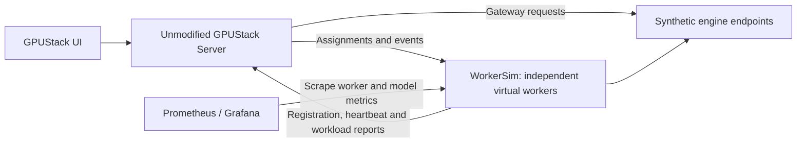

# GPUStack WorkerSim

[](https://github.com/pengjiang80/gpustack-workersim/actions/workflows/ci.yml)
[](https://hub.docker.com/r/gpustack/workersim)
[](pyproject.toml)

**Test GPUStack scheduling, deployment lifecycles, and monitoring on CPU-only machines.**

WorkerSim is a standalone worker protocol simulator for unmodified GPUStack. On Linux, one process can register up to **1000 independent workers**, expose virtual GPU/NPU inventories, receive assignments from the real scheduler, and report synthetic monitoring data to the standard UI.

WorkerSim has its own product version. See [Releases](https://github.com/pengjiang80/gpustack-workersim/releases) for the GPUStack version supported by each release. Like the native Worker, startup checks the Server version and logs a warning on a mismatch without blocking.

[中文说明](README.zh-CN.md) · [Quick start](#quick-start) · [Configuration](#configuration) · [Validation](#validation) · [Publishing](docs/publishing.md)

> GPUStack Server performs the scheduling; WorkerSim simulates the workers. No GPU hardware, model weights, or inference engines are required. Synthetic throughput, latency, utilization, and power values are not hardware benchmarks.

## Features

- **Independent identities:** worker registration, credentials, heartbeat, authenticated APIs, and persistent identities across restarts.
- **Configurable hardware:** worker count, accelerator profiles with custom device names and per-card memory, cards per worker, CPU, RAM, disk, and labels. Supports NVIDIA GPUs and Ascend CANN NPUs, including NVLink-domain topology facts and per-NPU RoCE addresses.
- **Deployment lifecycles:** receives real assignments and reports initialization, startup, running, failure, and stop transitions.
- **Scheduling scenarios:** ordinary replicas, cross-worker placement, PD prefill/decode/router roles, and tested vLLM/SGLang orchestration layouts with generation-fenced workload reports.
- **Native communication:** six event watches per worker, independent HTTP connections, native heartbeat/status cadence, watch caches, reconnect replay, authoritative cleanup checks, orphan-workload sweeps, and runtime-metrics reads, so Server load matches real Workers.
- **Model-file simulation:** download progress, Ready state, virtual paths, and synthetic file sizes without downloading weights.
- **Native monitoring:** Worker node families plus engine-native vLLM, SGLang, MindIE, PD-router and SGLang-gateway expositions, normalized on the Worker with the Server's `/v2/metrics/config` exactly like GPUStack's runtime-metrics aggregator.
- **Synthetic APIs:** chat, streaming chat, embeddings, reranking, transcription, and a short silent WAV speech fixture.
- **Fault controls:** simulate offline workers and runtime failure, then exercise GPUStack's normal recovery flow, including the Worker-side restart with exponential backoff (10 s doubling to 300 s) for `restart_on_error` models.

## Architecture



Server and WorkerSim can share a CPU host or run on different hosts. Server and Prometheus must be able to reach the advertised worker addresses.

## Quick start

### 1. Configure a test cluster

Use a GPUStack Server supported by your WorkerSim release. Create a test cluster in the UI and obtain its worker registration token from the **Add Worker** instructions.

```bash
git clone https://github.com/pengjiang80/gpustack-workersim.git
cd gpustack-workersim
```

Edit [`configs/docker.yaml`](configs/docker.yaml):

- `server.url`: Server root URL as reached from WorkerSim; do not append `/v2`.
- `server.cluster_id`: optionally specify the target cluster ID.
- `network.advertise_address` and `network.worker_ip`: an address reachable from Server and Prometheus.

The Docker example assumes a Linux host, Server on Docker's default bridge, and WorkerSim using host networking. `172.17.0.1` is an example gateway; use your host's actual address. A Server container's `127.0.0.1` refers to that container.

### 2. Reserve service ports

Before starting a fleet, reserve its inference port pool against automatic Linux source-port allocation. The example has two workers:

```bash
sudo python3 scripts/configure_port_reservations.py --workers 2 --apply
```

Adjust the count to match the configuration. The helper preserves existing reservations; existing connections and TIME_WAIT entries are not cleared.

### 3. Start WorkerSim

```bash
export GPUSTACK_REGISTRATION_TOKEN='<cluster-registration-token>'
docker pull gpustack/workersim:0.1.2
docker compose up -d --no-build
docker compose logs -f workersim
docker compose exec workersim workersim --config /config/fleet.yaml status
```

Compose enables automatic restart, persistent identity storage, host networking, and a file-descriptor limit of 65536. The **linux/amd64** image runs as UID **10001**, without privileged mode or a Docker socket mount.

Docker images are published at [`gpustack/workersim`](https://hub.docker.com/r/gpustack/workersim).
The previous Docker Hub repository was removed. Update existing Compose/image
references while keeping configuration mounts, identity volumes, container names,
and explicit port settings. The GitHub repository and Python package remain
`gpustack-workersim`.

Open the cluster in GPUStack UI. Workers should become **Ready**. Deploy models normally through UI or API; the real Server schedules them and WorkerSim simulates their startup.

## Configuration

Example: ten workers, eight B300 devices per worker:

```yaml
server:
  url: http://127.0.0.1:8080
  cluster_id: 1
network:
  advertise_address: 172.17.0.1
  worker_ip: 172.17.0.1
simulation:
  namespace: workersim-b300
  data_dir: /data
  registration_rate: 2
  reconcile_interval: 0
  model_requests_per_second: 2
worker_groups:
  - name_prefix: sim-b300
    count: 10
    gpu_profile: b300-288gb
    gpu_count: 8
    cpu_cores: 192
    memory_gib: 2048
    disk_gib: 8192
```

`model_requests_per_second` generates synthetic background traffic independently of client requests. Set it to `0` for idle model traffic.

### Accelerator profiles

| Profile | Device | Configured memory per device | Runtime |
|---|---|---:|---|
| `b300-288gb` | NVIDIA B300 | 288 GiB | CUDA |
| `h100-80gb` | NVIDIA H100 | 80 GiB | CUDA |
| `a800-80gb` | NVIDIA A800 | 80 GiB | CUDA |
| `rtx4090-24gb` | NVIDIA RTX 4090 | 24 GiB | CUDA |
| `ascend-910b4-64gb` | Ascend 910B4 | 64 GiB | CANN |

Capacity, driver/runtime versions, and power envelopes are simulation parameters. Ascend devices report `ascend/cann` and no CUDA compute capability.

### Custom device names and memory

Keep a built-in `gpu_profile` as the template and override either or both fields
in each worker group:

```yaml
worker_groups:
  - name_prefix: sim-custom
    count: 10
    gpu_profile: b300-288gb
    gpu_name: "My Test GPU"
    gpu_memory_gib: 144
    gpu_count: 8
    memory_gib: 2048
```

| Field | Meaning |
|---|---|
| `gpu_name` | Device name reported to GPUStack and used in monitoring labels. Must be a nonempty string; surrounding whitespace is trimmed. |
| `gpu_memory_gib` | Total memory **per card**, in GiB (`1 GiB = 2^30 bytes`). Accepts positive finite numbers, including fractions such as `96.5`; reports whole bytes. |
| `memory_gib` | Host RAM, independent of device memory. |

Omit an override or set it to `null` to inherit that value from the template.
Overrides apply to every card in the group and do not change other groups or the
built-in profiles. `reserved_vram_gib` must be smaller than the effective per-card
memory; its default is 1 GiB, so reduce it for devices with smaller capacities.

Vendor, CUDA/CANN type, architecture, compute capability, driver/runtime versions,
and power still come from the template. A new name does not select a different
backend or architecture: choose a template suitable for the scheduling scenario.
GPUStack receives the custom name and capacity through normal status reports;
monitoring uses the same values. Restart WorkerSim after editing the config,
keeping its identity volume and worker names.

### Topology and device network

| Field | Scope | Meaning |
|---|---|---|
| `nvlink_domain_workers` | worker group | Workers per multi-node NVLink domain, NVIDIA only. Each card reports the `nvidia.com/gpu.clique` topology hint (`<fabric-uuid>.0`) and each Worker reports the agreed `topology_facts`, like the native NVML fabric probe. Omit for single-host HGX systems, which report no domain. |
| `kv_transfer_ifname` | worker group | Reported verbatim as `kv_transfer_ifname`, like native `--kv-transfer-ifname`. |
| `npu_roce_cidr` | `network` | Synthetic per-NPU RoCE addresses (default `10.200.0.0/16`, 64 addresses per Worker slot). Ascend devices report `network.status: up` with these addresses, which MindIE distributed placement requires. Set `null` to report no device network. |

```yaml
worker_groups:
  - name_prefix: sim-gb300
    count: 36
    gpu_profile: b300-288gb
    gpu_count: 4
    nvlink_domain_workers: 18   # two NVL72 domains
```

See the [mixed GPU/NPU example](configs/custom-gpu.yaml). To use it with Compose,
adjust its addresses and mount it at `/config/fleet.yaml` instead of
`configs/docker.yaml`. Validate the edited file before starting:

```bash
workersim --config configs/custom-gpu.yaml validate
```

Fleet examples: [50 mixed GPU workers](configs/fleet-50.yaml), [100 eight-card B300 workers](configs/fleet-100-b300.yaml), [1000 eight-card B300 workers](configs/fleet-1000-b300.yaml), and [three eight-card 910B4 workers](configs/demo2-3-910b4.yaml).

### Networking and persistence

| Service | Default shared-IP allocation |
|---|---|
| Worker API | `20100–21099` for 1000 workers |
| Worker metrics | `21100–22099` for 1000 workers |
| Inference pool | 20 ports per worker, starting at `40000` |
| Fleet control | `127.0.0.1:20099` |

At 1000 workers, the inference pool spans **40000–59999**. The first worker uses `40000–40019`, the last `59980–59999`. These are simulator defaults; GPUStack Server is unchanged. Model listeners are opened only for assigned workloads. Complex distributed/PD layouts may need more ports on a worker; increase `network.instance_port_end` and reduce fleet size or use separate IPs/hosts. The reservation helper accepts matching `--ports-per-worker` and `--start-port` overrides.

Use distinct service pools for multiple simulator processes on one host. Optional `network.worker_ip_cidr` assigns separate worker IPs; configure host addresses and routing before startup. A Linux test-host helper is available in [`configure_virtual_network.py`](scripts/configure_virtual_network.py).

For 1000 workers, mount `configs/fleet-1000-b300.yaml` as `/config/fleet.yaml` in Compose and run `sudo python3 scripts/configure_port_reservations.py --workers 1000 --expand-ephemeral-range --apply`. The helper reserves API, metrics, control, and model ports, and explicitly expands the test host's automatic source-port range so thousands of independent outbound connections fit. Keep `nofile=65536`.

Each worker has **six persistent event watches** and its own connection pool. Heartbeat/status reports start immediately and repeat every 30 seconds after completion. Runtime metrics retain the native Worker lookup cadence. There is no fleet-wide REST limiter or shared connection pool to reduce Server pressure. See the [communication contract](docs/native-worker-communication.md) for endpoints, cache behavior, retry timing, and supported execution scope.

By default WorkerSim starts at most 5 workers/s (`registration_rate`), with up to 8 workers starting concurrently (`registration_concurrency`); these settings affect fleet startup only. Keep `reconcile_interval: 0` for the native cache-backed behavior. Size the Server/database for the generated load; 1000-worker simulator capacity is not a scheduler throughput guarantee. Acceptance can use GPUStack's documented database pool settings without changing Worker traffic.

Keep the data directory or Docker volume to preserve identities. Each namespace belongs to one Server URL and has a process lock. Fleet configuration changes require a restart; retain worker names and group order to preserve port assignments.

## Deployment and failure testing

For an automated replica scenario, provide a GPUStack platform administrator API key:

```bash
export GPUSTACK_API_KEY='<gpustack-platform-admin-api-key>'
workersim --config configs/local.yaml scenario --replicas 2 5 1 0 --timeout 300
```

This creates an owned test model, changes replicas, waits for convergence, then deletes that test model. Results go to `outputs/scenario.json`. Elapsed time includes scheduling, simulated startup, and controller convergence.

Simulate online worker counts within the configured fleet:

```bash
workersim --config configs/local.yaml fleet-scale 1
workersim --config configs/local.yaml fleet-scale 2
workersim --config configs/local.yaml stop
```

`fleet-scale` changes availability, rather than registering or deleting workers. GPUStack's heartbeat grace period determines when offline state appears in UI. The loopback control API also supports instance failure injection through `POST /fault`.

## Validation

These are integration snapshots under the configurations and versions described in each report.

| Scenario | Result | Report |
|---|---|---|
| demo2 upgrade / custom GPU reporting | 53 simulated workers and 28 models retained; custom CUDA/CANN names and memory verified | [Upgrade and image migration](docs/demo2-upgrade-2026-11-20.md) |
| Native communication / 1000-Worker protocol fixture | 8000 devices, 6000 watches; original-Server 500/1000 stability not yet passed | [Scale validation and limits](docs/scale-1000-validation.md) |
| Original GPUStack | 100 workers, 800 simulated B300 devices | [Integration](docs/workersim-040-validation.md) |
| GLM-5.3 PD 5P3D | Tested at 10, 20, 40, 60, 80 and 100 workers | [Scale experiment and version boundaries](docs/glm53-pd-benchmark-2026-11-17.md) |
| Tested GPUStack enterprise build | 50 B300 workers, 16 models, 116 running replicas | [Deployment acceptance](docs/demo2-deployment-2026-11-17.md) |
| Ascend CANN inventory | 3 workers, 24 devices, 64 GiB each | [910B4 acceptance](docs/demo2-910b4-2026-11-17.md) |

Compatibility details and the protocol source commit are recorded in each [Release](https://github.com/pengjiang80/gpustack-workersim/releases). Other versions need separate validation. `server.allow_version_mismatch` is deprecated and ignored: a version mismatch only logs a warning, as on the native Worker.

## Scope and limitations

- No real inference, weight downloads, GPU kernels, NCCL/Ray transport, or KV-cache data transfer occurs.
- Embeddings are deterministic fixture vectors; reranking uses fixed order; transcription returns a simulation message; speech returns a **0.25-second silent WAV**, regardless of the requested encoding.
- Synthetic metrics are unsuitable for inference benchmarking, request auditing, or billing. Model series appear after the native 30-second aggregation delay and expire 30 seconds after the last successful pass.
- Benchmarks and cache services are watched and polled like native Workers, but their executions and logs (`/benchmark_logs`, `/cacheServiceInstanceLogs`) are not simulated. Tunnel proxy mode, `/cluster-proxy`, and GGUF parsing are also not simulated.
- Managed (workload-report) instances recover through the Server; WorkerSim does not run the native managed-workload sync for them.
- Scheduling and allocation decisions belong to GPUStack Server. Not every backend/layout combination has been validated.
- Some legacy instance download percentages remain intermediate in the tested enterprise build even when Model Files are Ready/100% and instances are Running; see the acceptance report.

## Development

Python **3.11+** is required. Linux is recommended for larger fleets.

```bash
python3 -m venv .venv
. .venv/bin/activate
pip install -e '.[dev]'
workersim --config configs/local.yaml validate
ruff check workersim scripts tests
ulimit -n 65536
pytest -q
```

Edit the local config's addresses and data directory, set the registration token, then run `workersim --config configs/local.yaml run`. On Windows, activate `.venv\Scripts\Activate.ps1`.

Protocol tests use a loopback control-plane fixture; real Server/UI integration is verified separately. CI runs on Linux with Python 3.12. Release instructions, version tags, and Docker Hub setup are in the [publishing guide](docs/publishing.md).

## License

See [LICENSE](LICENSE). Derived GPUStack helpers retain their [original license](workersim/_vendor/LICENSE-GPUStack.txt) and [attribution](workersim/_vendor/NOTICE.md).
